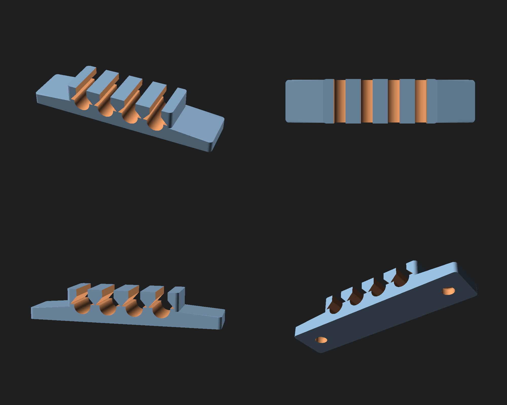

# 🖨️ Parametric 3D Print Foundry

> **100% Zero-Support FDM Parametric 3D Models** — Optimized for MakerWorld Customizer & Desktop OpenSCAD.

🌐 **Live Web3 Storefront:** [https://manhtungnguyen940610.github.io/parametric-3d-foundry/](https://manhtungnguyen940610.github.io/parametric-3d-foundry/)

---

## 🎨 Model Catalog Gallery

| Preview | Model ID & Title | Category & Highlights | Downloads |
| :---: | :--- | :--- | :---: |
|  4-Angle Studio Preview | **Parametric Under-Desk & Wall Multi-Cable Clamp** `scad_001_cable_clamp`  📁 *Cable Management / Organization* | • <b>num_slots</b>: 1 to 8 cables • <b>cable_diameter</b>: 3.0 to 12.0 mm • <b>clamp_style</b>: Screw (Countersunk M3/M4) or VHB Tape channel • <b>lip_retention</b>: Snap-in retention tabs | [STL](docs/models/scad_001_cable_clamp/scad_001_cable_clamp.stl) [SCAD](docs/models/scad_001_cable_clamp/scad_001_cable_clamp.scad) [Docs](docs/models/scad_001_cable_clamp/README.md) |

---

## ☕ Support & Commercial Licensing
Free for personal 3D printing. For commercial licensing or donations:
- **Base Mainnet (ETH / USDC):** `0x558dF083eE52Fd344055b01943b55f96259F6684`
- **Instant Web3 Checkout:** [https://manhtungnguyen940610.github.io/parametric-3d-foundry/](https://manhtungnguyen940610.github.io/parametric-3d-foundry/)
